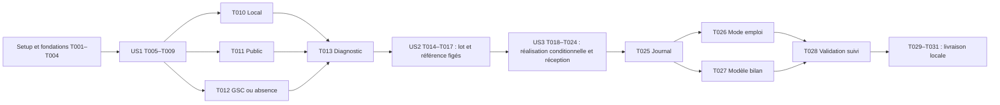

# Tasks: Améliorer la visibilité naturelle d’EcoBalcon

**Input**: documents de `specs/002-ameliorer-visibilite-naturelle/`.
**Prerequisites**: [plan.md](plan.md), [spec.md](spec.md), [research.md](research.md), [data-model.md](data-model.md), [contracts/](contracts/), [quickstart.md](quickstart.md).
**Date**: 2026-11-01. Branche Git réelle : `setup/spec-kit-ecobalcon`. La fonctionnalité active est la 002, indépendamment de l’onglet 001 ouvert dans l’IDE.

**Tests**: pas de TDD ni de tâches de test autonomes ajoutées. Les fixtures ciblées prévues par le plan et le contrat de l’auditeur font partie de la vérification de son implémentation (T008). Les contrôles d’acceptation demandés par la spécification sont intégrés aux tâches correspondantes. Aucun test de l’implémentation n’est exécuté pendant la génération de cette liste.

**Organization**: tâches organisées par scénario utilisateur. Toutes les cases décrivent du travail futur ; aucune correction du site ou publication n’est réalisée par cette commande.

**Reprise du 2026-11-16** : diagnostic et s?lection finalis?s, r?f?rence avant correction fig?e. Lot retenu : trois actions sur quatre URLs. G?n?ration isol?e, application locale et r?ception statique termin?es. T024 reste ouverte : contr?les visuels et clavier indisponibles via la liaison Chrome. Aucun commit ni publication. Preuves et limites dans [diagnostic/validation.md](diagnostic/validation.md).

## Format: `[ID] [P?] [Story] Description`

- `[P]` : exécution parallèle possible uniquement après les prérequis indiqués et sur les fichiers attribués distincts.
- `[US1]` à `[US4]` : rattachement aux quatre scénarios de la spécification.
- Chaque tâche mentionne ses chemins d’entrée ou de sortie ; les tâches de réalisation utilisent la liste nominative de sources et d’URLs arrêtée en T016, sans choisir d’autres pages.

## Path Conventions

Tous les chemins ci-dessous sont relatifs à la racine du dépôt. Les rapports sont sous `specs/002-ameliorer-visibilite-naturelle/diagnostic/`. Aucun répertoire d’application, serveur, base de données ou paquet tiers à créer.

Les fichiers d’article et de catégorie précis ne peuvent pas être nommés avant le diagnostic : T015–T016 doivent consigner leurs chemins exacts dans `diagnostic/actions.md`, qui devient l’entrée obligatoire de T018–T024. Les mentions de `scripts/article-overrides.ps1` ou de `categories/**/index.html` désignent les sources durables possibles, pas une autorisation de modifier toute la famille.

## Phase 1: Setup — Préserver et organiser le travail courant

**Purpose**: identifier un état fiable sans toucher aux changements déjà présents.

- [X] T001 Lire `AGENTS.md` et `.specify/memory/constitution.md`, vérifier `.specify/feature.json`, branche, `git status --short` et diff utile ; créer `specs/002-ameliorer-visibilite-naturelle/diagnostic/journal.md` avec les changements préexistants, y compris fichiers non suivis et travail 001, et les empreintes initiales de `index.html`, `js/simulateur.js`, `simulateur/index.html` et des sources de génération, sans restaurer ni commiter quoi que ce soit.
- [X] T002 Vérifier Git/Python/PowerShell et préparer uniquement les répertoires documentaires nécessaires sous `specs/002-ameliorer-visibilite-naturelle/diagnostic/` ; réserver `initial/` et `final/` nouveaux ou vides pour l’auditeur, désigner dans `diagnostic/journal.md` un emplacement local exclu de Git pour d’éventuels exports bruts, sans installer de dépendance, modifier l’hébergement ou créer une intégration.

---

## Phase 2: Foundational — Référence et règles communes

**Purpose**: établir les règles partagées avant les scénarios.

- [X] T003 Initialiser `specs/002-ameliorer-visibilite-naturelle/diagnostic/baseline.json` selon `data-model.md` : identifiants stables et références, dates civiles `YYYY-MM-DD`, instants ISO 8601 avec décalage UTC ; appliquer « Une absence est `null` avec motif ; elle n’est jamais remplacée par zéro. » et « Avant publication, `publication_at` et `due_date` sont `null`. » ; ne déclarer ni source GSC disponible ni groupe de pages figé avant leur vérification.
- [X] T004 Créer dans `specs/002-ameliorer-visibilite-naturelle/diagnostic/validation.md` la matrice FR-001 à FR-015 et SC-001 à SC-007 avec preuves attendues, familles à échantillonner et critères de préservation ; reprendre « Résultat de contrôle : `conforme`, `anomalie`, `non_verifie`, `sans_objet`, avec raison et preuve. » ; initialiser les contrôles non exécutés à `non_verifie`, sans cocher la checklist de qualité des exigences.

**Checkpoint**: photographie du travail, référence encore incomplète et matrice de réception disponibles ; aucune page du site modifiée.

---

## Phase 3: User Story 1 — Comprendre les obstacles et opportunités (Priority: P1) — MVP

**Goal**: livrer un diagnostic daté et vérifiable, utile avec ou sans données de recherche.

**Independent Test**: à partir de `diagnostic/diagnostic.md`, retrouver inventaire, familles contrôlées, preuves/limites de chaque constat et statut des données GSC ; aucune présence locale ou entrée sitemap ne vaut preuve d’indexation.

### Implementation for User Story 1

- [X] T005 [US1] Créer l’interface et les accès fichiers de `scripts/seo_audit.py` selon `contracts/audit-cli.md` : Python standard, `--root`, `--output-dir` résolus, écriture uniquement sous le répertoire documentaire autorisé, refus d’une destination remplie ou hors périmètre, absence de réseau/correction/publication et de suivi de liens de répertoire hors racine ; codes de sortie `0` pour rapport complet même avec anomalies, `1` pour erreur/rapport incomplet, `2` pour arguments invalides.
- [X] T006 [US1] Implémenter dans `scripts/seo_audit.py` l’inventaire des HTML et leurs données de page selon `data-model.md`, avec familles, URL publique originale, chemin et source durable, canonical, consignes et redirections ; reprendre « `candidate_recherche`, `redirection`, `exclusion_existante`, `a_examiner` ; classification technique locale, pas état Google. » et « état Google `inconnu` sans preuve dédiée. » ; une classe par page, redirections HTML distinctes des statuts HTTP, exclusions du contrat rendues explicites.
- [X] T007 [US1] Ajouter dans `scripts/seo_audit.py` les contrôles locaux title/description/H1, canonical/hreflang/OG/Twitter, JSON-LD syntaxique et cohérence des URLs, sitemap/robots, dates, liens et images ; résoudre dossiers et chemins encodés en séparant paramètres/fragments et schémas externes, signaler les cibles absentes sans les corriger, garder preuves et limites sans score SEO global ni seuil imposé de longueur.
- [X] T008 [US1] Finaliser les sorties `inventory.json` avec `schema_version=1` et `local.md` dans `scripts/seo_audit.py`, incluant les champs du modèle et empreintes des HTML/fichiers partagés ; créer les petites fixtures temporaires de vérification dans `scripts/tests/test_seo_audit.py` et exécuter `python -m unittest discover -s scripts/tests -p 'test_seo_audit.py'` pour vérifier canonical/dossiers/legacy, noindex et anomalies JSON-LD/liens/images, exclusions/refus d’écriture et invariance des octets d’entrée ; corriger tout échec avant d’utiliser l’outil sur le site.
- [X] T009 [US1] Exécuter l’auditeur validé vers `specs/002-ameliorer-visibilite-naturelle/diagnostic/initial/`, relire `inventory.json` et `local.md`, vérifier couverture et partition de tous les HTML, présence d’empreintes y compris fichiers partagés/état sitemap et absence de modification du site ; figer aussi dans diagnostic/echantillon.json la liste nominative des URLs à contrôler par famille avant T010/T011 ; conserver la référence sans la réécrire, expliquer tout écart avec les comptes préparatoires du plan au lieu de figer artificiellement ces comptes.
- [X] T010 [P] [US1] Après T009, réaliser les contrôles humains locaux dans `specs/002-ameliorer-visibilite-naturelle/diagnostic/local-review.md` : nommer au moins un exemple de chaque famille réellement présente, examiner besoin/réponse, contenu utile, maillage, images, structure et obstacles de lecture/chargement sur mobile ; consigner chaque constat avec date, chemins/valeurs observés, effet possible, confiance et limites ; revérifier les observations de `SEO-AUDIT.md` avant toute reprise.
- [X] T011 [P] [US1] Après T009, vérifier les URLs publiques de l’échantillon, robots, sitemap et destinations legacy accessibles, et consigner dans `specs/002-ameliorer-visibilite-naturelle/diagnostic/public-review.md` les preuves datées et écarts local/public ; garder `non_verifie` si l’outil échoue, sans en déduire une panne ; si une consultation Google autorisée existe, distinguer version indexée/test en direct, sans demander d’indexation ni envoyer de formulaire de contact.
- [X] T012 [P] [US1] Après T009, rechercher un accès GSC en lecture ou export existant et consigner dans `specs/002-ameliorer-visibilite-naturelle/diagnostic/search-data.md` et `diagnostic/baseline.json` la disponibilité « `absent`, `inutilisable`, `partiel`, `exploitable`, avec motif. » ; si exploitable, relever propriété/source/extraction, 28 jours complets non préliminaires et 28 précédents, dates inclusives/fuseau, filtres/types/dimensions/agrégations, couverture et règle de marque ; conserver pour `aggregation` « `propriete`, `page`, `requete` ou autre portée documentée. », les statuts « `mesure`, `indisponible`, `ambigu_export` » et « `clicks` et `impressions` mesurés sont des entiers positifs ou nuls ; `ctr` est un ratio de 0 à 1 ; `position` est positive si connue. » ; sans source, garder des valeurs `null` motivées et poursuivre ; aucune jointure page × requête inventée, reconstitution du total par somme des requêtes/pages, nouveau compte, secret demandé ou intégration ajoutée.
- [X] T013 [US1] Après T010–T012, consolider `specs/002-ameliorer-visibilite-naturelle/diagnostic/diagnostic.md` : inventaire et couverture, familles/URLs échantillonnées, preuves dont `environment` conserve « `local`, `public`, `google` », limites GSC et hypothèses éditoriales ; appliquer aux constats « Un constat vérifié nécessite une preuve datée. » et « `non_verifie` exige une raison. » avec les champs d’observation du modèle, sans reprendre la note de juin ni déclarer de trafic ou d’indexation non observés.

**Checkpoint**: US1 livrable seule : diagnostic utile et traçable ; données facultatives explicitement présentes ou absentes, aucune correction du site.

---

## Phase 4: User Story 2 — Choisir un premier lot utile et limité (Priority: P1)

**Goal**: sélectionner un lot motivé et arrêter ses limites avant toute réalisation.

**Independent Test**: relire `diagnostic/actions.md` et `baseline.json` ; chaque action sélectionnée a preuve, besoin, URLs et critère avant/après ; l’union respecte trois actions/cinq pages, ou le lot vide est justifié.

### Implementation for User Story 2

- [X] T014 [US2] À partir de T013, établir les propositions dans `specs/002-ameliorer-visibilite-naturelle/diagnostic/actions.md` avec tous les champs d’action de `data-model.md`, constats liés, besoin/intention et classement ; citer « Niveaux de bénéfice, confiance, effort et risque : `faible`, `moyen`, `fort`, accompagnés d’une justification. Aucun score SEO global. » et « `decision` : `candidate`, `retenue`, `reportee`, `abandonnee`. » ; examiner d’abord l’accès aux contenus, puis confiance/bénéfice et moindre effort/risque, sans inventer de volume de recherche.
- [X] T015 [US2] Compléter chaque fiche de `specs/002-ameliorer-visibilite-naturelle/diagnostic/actions.md` par les chemins exacts de sources/sorties, critères observables et contrôles avant/après ; inspecter les effets possibles de `SeoTitle`, `Title`, `Description`/`Intro`, cartes, rapprochements, index, auteurs, variantes legacy et fichiers partagés dans `scripts/article-overrides.ps1` et `scripts/rebuild_articles.ps1`, ou le HTML durable d’une catégorie ; nommer toutes les URLs directes/indirectes et fichiers techniques ; avant sélection T016, effectuer les contrôles humains de lecture et de parcours sur toutes les pages proposées pour le lot, y compris celles absentes de l’échantillon initial, et compléter leurs preuves ou limites dans `diagnostic/local-review.md`, sans encore modifier le site.
- [X] T016 [US2] Arrêter la sélection et les reports dans `specs/002-ameliorer-visibilite-naturelle/diagnostic/actions.md` en appliquant « Invariants : zéro à trois actions ; union de zéro à cinq URLs existantes ; aucun nouvel article ; accueil absent des pages modifiées. » ; dédupliquer l’union directe/indirecte, compter aussi les effets de fichiers partagés sans différence HTML, reporter les travaux trop larges et opportunités d’accueil ; accepter un lot vide motivé avec preuves à obtenir, sans quota artificiel.
- [X] T017 [US2] Avant toute correction US3, figer dans `specs/002-ameliorer-visibilite-naturelle/diagnostic/baseline.json` le lot, groupe exact d’URLs, empreintes de départ, référence GSC disponible pour ce groupe et le site séparément, périodes/filtres/agrégations et limites ; enregistrer l’état `selectionne` et la date dans `diagnostic/journal.md`, sans remplir de publication ; en cas de source absente ou partielle garder les mesures inconnues motivées, sans reporter la création de la référence après les corrections.

**Checkpoint**: lot et état initial figés avant US3 ; aucune URL choisie implicitement pendant la réalisation.

---

## Phase 5: User Story 3 — Améliorer les pages en préservant les usages (Priority: P2)

**Goal**: appliquer uniquement le lot retenu, vérifier sa durabilité et sa réception locale.

**Independent Test**: comparer chaque page du lot à sa référence, suivre ses variantes legacy et contrôler critères éditoriaux, métadonnées, liens/images et parcours ordinateur/mobile/clavier. Une absence de contrôle n’est pas une validation.

**Branche conditionnelle**: si T016 a retenu un lot vide, T018–T022 sont terminées seulement après inscription explicite de leur résultat `sans_objet` et du motif dans `diagnostic/validation.md`. Ne créer aucune correction ou copie d’essai artificielle. T023–T024 vérifient alors la préservation et documentent la réception d’un dossier sans changement de page.

### Implementation for User Story 3

- [X] T018 [US3] Pour un lot non vide, compléter `specs/002-ameliorer-visibilite-naturelle/diagnostic/journal.md` et créer `diagnostic/generation-review.md` avec les chemins de la photographie et de la copie isolée de l’état courant, incluant modifications non commitées, sources HTML de repli, dates et `scripts/sitemap-page-state.json`, sans copier profils ou exports privés ; capturer les empreintes de chaque destination potentielle et l’absence des nouvelles destinations, sans utiliser HEAD comme seule référence ni supprimer de sauvegarde existante.
- [X] T019 [US3] Dans la copie isolée de T018, réaliser les seules corrections décrites par `specs/002-ameliorer-visibilite-naturelle/diagnostic/actions.md` : champs ciblés de `scripts/article-overrides.ps1` pour articles, `BodyHtml` durable si révision substantielle, ou HTML durable de catégorie dont le chemin exact a été nommé en T015 ; lire `prompt codex.txt` si révision éditoriale, vérifier les faits décisifs et noter les sources dans `diagnostic/generation-review.md` ; conserver conseils/images/attributs, dates de publication, URLs et métadonnées cohérentes, sans toucher accueil, mesures, consentement ou coordonnées.
- [X] T020 [US3] Dans la copie isolée, analyser la syntaxe de tout PowerShell modifié et exécuter, seulement si nécessaire aux sorties du lot, `scripts/rebuild_articles.ps1` sans `-RebuildHome`, après vérification de l’accueil existant ; consigner dans `specs/002-ameliorer-visibilite-naturelle/diagnostic/generation-review.md` toutes les différences sources/sorties, dates et état sitemap, y compris effets de l’absence éventuelle d’historique Git ; ne lancer ni `scripts/strategic_enhance.ps1` ni processus de publication et ne pas considérer le code de retour comme preuve suffisante.
- [X] T021 [US3] Comparer tous les fichiers de la copie à sa capture et mettre à jour `specs/002-ameliorer-visibilite-naturelle/diagnostic/generation-review.md` et `diagnostic/actions.md` : compter toute page réellement différente et tout effet de fichier partagé, distinguer réécriture identique et fichier technique, contrôler les invariants de T016 ; si le lot dépasse cinq URLs ou un invariant, réduire/reporter l’action et refiger la référence avant nouvelle réalisation, sans appliquer au dépôt ni éliminer arbitrairement des sorties nécessaires pour cacher le dépassement.
- [X] T022 [US3] Réappliquer au dépôt le jeu cohérent de sources/sorties validé en T021 et nommé dans `specs/002-ameliorer-visibilite-naturelle/diagnostic/actions.md`, après comparaison de chaque empreinte de destination à la capture T018 ; si elle a changé ou si une destination nouvelle est apparue, réconcilier le travail concurrent avant écriture ; consigner les fichiers réellement appliqués dans `diagnostic/journal.md`, sans restauration globale ni écrasement du travail 001.
- [X] T023 [US3] Produire `specs/002-ameliorer-visibilite-naturelle/diagnostic/final/inventory.json` et `local.md` via l’auditeur, comparer à `diagnostic/initial/inventory.json` et consigner dans `diagnostic/validation.md` tous les contrôles statiques des pages/variantes concernées : mêmes URLs/canonicals/destinations, aucune exclusion nouvelle, titres/résumés fidèles, dates et informations structurées cohérentes, liens/images valides, plafond et accueil préservés ; inscrire les anomalies préexistantes séparément des régressions du lot et corriger celles-ci avant réception.
- [ ] T024 [US3] Exécuter les contrôles visibles de `quickstart.md` pour les URLs du lot, à 1280 px, 390 px et au clavier, sur une version locale fraîche ; enregistrer critères par action, preuves et limites dans `specs/002-ameliorer-visibilite-naturelle/diagnostic/validation.md`, vérifier les parcours affectés et, si le simulateur l’est, exécuter `scripts/tests/simulateur-results.test.cjs` ; si suivi/consentement ont été touchés par inadvertance, corriger le dépassement et utiliser `scripts/tests/affiliate-tracking.test.cjs` si pertinent ; ne pas déclarer validé un contrôle manquant ou un résultat public déduit du local.

**Checkpoint**: critères locaux satisfaits ou limites explicites ; aucune régression masquée ; statut `non_publie`, sans promesse de trafic. Un contrôle requis manquant interdit une réception déclarée complète.

---

## Phase 6: User Story 4 — Savoir ce qui a changé et quand réévaluer (Priority: P2)

**Goal**: livrer le journal et un protocole de bilan exploitable, sans publier ni attendre huit semaines pendant l’implémentation.

**Independent Test**: depuis la référence et le journal, retrouver périodes, filtres, groupe fixe et échéances conditionnelles ; pouvoir remplir un bilan descriptif ou « non concluant » en traitant données absentes, référence nulle et recul incomplet.

### Implementation for User Story 4

- [X] T025 [US4] Rapprocher `specs/002-ameliorer-visibilite-naturelle/diagnostic/baseline.json`, `diagnostic/actions.md`, `diagnostic/validation.md` et `diagnostic/journal.md` pour tracer chaque action, pages, contrôles/limites, changements concurrents et état de livraison ; conserver les transitions du modèle `diagnostic` → `selectionne` → `en_realisation` → `reception_locale` → `non_publie`, avec passage direct `selectionne` → `reception_locale` pour lot vide ; ne pas créer rétrospectivement de données initiales et conserver les dates de publication/échéance nulles sans publication autorisée constatée.
- [X] T026 [P] [US4] Après T025, rédiger `specs/002-ameliorer-visibilite-naturelle/diagnostic/suivi-mode-emploi.md` selon le contrat de suivi : déclenchement seulement après publication explicitement demandée et constatée, disponibilité sous sept jours, bilans J+28/J+56 avec les 28 derniers jours complets disponibles, dates/fuseau/filtres/agrégations conservés, groupe fixe et site séparés, contexte saisonnier et changements concurrents ; expliquer le chevauchement possible avant publication à J+28, sans tâche planifiée, intégration ou publication automatique.
- [X] T027 [P] [US4] Après T025, créer `specs/002-ameliorer-visibilite-naturelle/diagnostic/bilan-modele.md` avec tous les champs Bilan de `data-model.md`, sans faux résultat ni date de publication supposée ; citer « `conclusion` : `progression`, `stabilite`, `recul`, `non_concluant`. » et les règles « pourcentage relatif seulement si référence non nulle. Pour le CTR, donner aussi l’écart en points. » ; prévoir valeurs/écarts, CTR pondéré si données de pages complètes, position de même portée ou absente, limites et prochaine décision, sans moyenne simple des positions/CTR ni attribution causale certaine.
- [X] T028 [US4] Après T026–T027, vérifier documentairement le protocole et reporter dans `specs/002-ameliorer-visibilite-naturelle/diagnostic/validation.md` les cas sans GSC, source incompatible/partielle, référence zéro, données préliminaires et exposition incomplète ; appliquer « Absence de données, périmètre différent, période incomplète, impressions nulles sur une période ou exposition incomplète : `non_concluant`, avec les valeurs disponibles conservées. » ; vérifier aussi qu’un cas réellement comparable permet une tendance descriptive selon le signe des clics, sans présenter une simulation comme une performance EcoBalcon mesurée.

**Checkpoint**: dossier de suivi utilisable immédiatement ; les mesures futures restent un engagement documentaire hors exécution automatique. Aucun bilan réel n’est inventé pour cocher une tâche.

---

## Phase 7: Polish & Cross-Cutting Concerns — Réception du périmètre livré

**Purpose**: terminer les contrôles transversaux, sans élargir le lot.

- [X] T029 Relire la traçabilité de toutes les exigences/scénarios dans `specs/002-ameliorer-visibilite-naturelle/diagnostic/validation.md`, appliquer les scénarios utiles de `quickstart.md` et contrôler les liens entre preuves, actions, référence et journal ; distinguer contrôles exécutés, limites, branches sans objet et observations futures, sans modifier `spec.md` ou les cases de `checklists/requirements.md` pour masquer un écart.
- [X] T030 Exécuter `git diff --check`, examiner toutes les nouvelles différences, y compris fichiers non suivis et sorties de génération, comparer empreintes et changements préexistants de T001/T009, et consigner le résultat dans `specs/002-ameliorer-visibilite-naturelle/diagnostic/validation.md` ; confirmer accueil, URLs, contenus utiles, identifiants et fonctions préservés, plafond tenu et absence d’exécution de `scripts/strategic_enhance.ps1` et de publication automatique ; corriger seulement les problèmes introduits par ce lot.
- [X] T031 Finaliser `specs/002-ameliorer-visibilite-naturelle/diagnostic/journal.md` avec livrables, critères reçus, limites réelles et prochaine décision ; livrer le bilan local à la personne responsable en distinguant explicitement non-publication et indexation inconnue, avec échéances différées seulement conditionnelles, sans push, déploiement, `publish.bat`, soumission à un moteur ou attente de huit semaines.

---

## Dependencies & Execution Order

### Phase Dependencies

1. Phase 1 : T001 → T002.
2. Phase 2 : T003 → T004, après la phase 1 ; fondations communes bloquantes.
3. US1 : T005 → T006 → T007 → T008 → T009 ; puis T010, T011 et T012 indépendantes ; T013 attend les trois résultats, y compris les limites documentées.
4. US2 : T014 → T015 → T016 → T017 après T013. T017 est la barrière avant toute correction US3, même si le suivi métier est exposé en US4.
5. US3 : T018 → T019 → T020 → T021 → T022 → T023 → T024. Si T021 réduit le lot, mettre à jour T016–T017 avant une nouvelle réalisation ; ne pas altérer la photographie historique. Les corrections/amendements de sélection sont journalisés, pas ajoutés comme un nouveau périmètre implicite.
6. US4 : T025 après T024 ; T026 et T027 indépendantes après T025 ; T028 attend les deux. Le protocole pourrait être préparé après T017 dans des fichiers distincts, mais le journal partagé est écrit séquentiellement.
7. Phase finale : T029 → T030 → T031, après T028.

### User Story Dependencies

US1 est indépendante des corrections et constitue le MVP. US2 consomme le diagnostic US1 ; elle reste démontrable sans changer le site. US3 exige les URLs et la référence figées d’US2. US4 utilise la référence capturée avant correction et les résultats de réception ; son protocole est vérifiable sans publication. Ces dépendances correspondent au métier et ne sont pas remplacées par une indépendance artificielle des phases.

### Within Each User Story

Livrer d’abord les données/preuves nécessaires puis leur synthèse. Les vérifications du parseur suivent son implémentation et précèdent son usage réel ; aucune obligation de TDD. Les validations de réception ne sont pas reportées après la déclaration de réussite. Les tâches conditionnelles restent exécutables par leur branche « sans objet » justifiée, pas par une modification du site inventée.

### Parallel Opportunities

Cinq tâches portent `[P]` : T010/T011/T012 après T009, puis T026/T027 après T025. Aucune modification concurrente d’un même rapport, script, baseline ou journal. Les autres tâches restent séquentielles ; les sous-agents reçoivent un fichier ou un ensemble distinct et leurs résultats sont relus avant consolidation.

---

## Parallel Examples by User Story

### US1

Après T009, attribuer `diagnostic/local-review.md` à un agent, `diagnostic/public-review.md` à un second et `diagnostic/search-data.md` avec `baseline.json` à un troisième. T013 seul consolide ensuite `diagnostic.md`. Les sous-agents ne modifient ni le site ni le journal commun.

### US2

T014–T017 sont séquentielles, car elles partagent `actions.md` et la sélection. Des sous-agents peuvent relire les candidats ou rechercher leurs effets en lecture seule ; un seul auteur écrit le lot et fige la référence.

### US3

T018–T024 sont séquentielles, y compris génération et application. Après T022, des lectures de pages distinctes peuvent être distribuées sans modifier les fichiers du site ; un seul auteur reporte les résultats de réception dans `validation.md`. Aucun `[P]` ne permet de copier ou générer en concurrence.

### US4

Après T025, attribuer `diagnostic/suivi-mode-emploi.md` à un agent et `diagnostic/bilan-modele.md` à un autre. T028 seul consolide leur vérification dans `validation.md`.

---

## Implementation Strategy

### MVP First — User Story 1 Only

Réaliser T001–T013 : auditeur, inventaire, contrôles par famille et diagnostic sourcé avec ou sans GSC. Valider le checkpoint US1 et livrer ce premier résultat local. Une pause au MVP est possible, mais ne signifie pas que toute la fonctionnalité est terminée. Aucun déploiement n’est nécessaire pour démontrer cet incrément.

### Incremental Delivery

1. Ajouter US2 pour fournir une décision courte et la référence figée.
2. Réaliser US3 seulement pour le lot justifié, en préservant le travail existant et le plafond ; le lot vide livre une décision documentée sans correction artificielle.
3. Ajouter US4 et la réception transversale pour terminer le dossier local.
4. Consigner seulement un protocole pour l’observation future ; une publication exige une nouvelle demande explicite, puis les bilans réels seront réalisés lorsqu’ils seront possibles.

### Parallel Team Strategy

Exploiter uniquement les deux groupes `[P]` après leurs barrières. Garder un responsable pour `scripts/seo_audit.py`, un responsable de consolidation des rapports partagés et un responsable des écritures de réalisation. Toute modification concurrente découverte par les empreintes est réconciliée avant application.

## Coverage and Counts

| Périmètre | Tâches | Nombre | Résultat vérifiable |
| --- | --- | ---: | --- |
| Setup | T001–T002 | 2 | Travail existant identifié, sorties documentaires réservées. |
| Fondations | T003–T004 | 2 | Référence/matrice initialisées sans fausse mesure. |
| US1 — P1 | T005–T013 | 9 | Diagnostic daté, preuves et limites ; GSC facultative. |
| US2 — P1 | T014–T017 | 4 | Lot nominatif plafonné et référence figée avant correction. |
| US3 — P2 | T018–T024 | 7 | Préservation et réception locale du lot, ou branche vide justifiée. |
| US4 — P2 | T025–T028 | 4 | Journal/protocole/bilan préparés, cas non concluants traités. |
| Finalisation | T029–T031 | 3 | Dossier cohérent, diff contrôlé et bilan local. |
| Total | T001–T031 | 31 | Aucun acte de publication inclus. |

| Exigences | Tâches principales |
| --- | --- |
| FR-001 à FR-003 ; SC-001 | T005–T011, T013 |
| FR-004 à FR-005 ; SC-004 | T003, T012–T013, T017, T028 |
| FR-006 à FR-008 ; SC-002 | T014–T017, T021 |
| FR-009 à FR-011 ; SC-003 | T018–T024, T030 |
| FR-012 | T001, T003, T012, T017, T025 |
| FR-013 à FR-014 ; SC-005 à SC-006 | T026–T028 ; bilans réels différés après publication autorisée |
| FR-015 ; SC-007 | T016, T018–T031 selon leur périmètre ; aucune publication |

Entités : pages et constats en US1 ; données de recherche en T012 avec référence commune T003 ; actions/lot en US2 ; réalisation/réception en US3 ; journal et bilan en US4, initialisés avant correction. Contrat CLI → US1 ; contrat de préservation → US2/US3 ; contrat de suivi → T012/T017 et US4.

## Notes

- Ce découpage respecte le plafond d’actions sur le site ; les 31 tâches incluent l’outil de diagnostic et les vérifications, ce ne sont pas 31 changements éditoriaux.
- Les contrôles impossibles restent explicites, sans équivaloir à une réception réussie ; des données externes indisponibles ne bloquent pas le diagnostic local.
- Ne pas changer la qualité des exigences ou les résultats historiques pour cocher une tâche.
- Le template actif a été résolu par `setup-tasks.ps1 -Json` : `.specify/templates/tasks-template.md`. Aucun hook avant/après tasks à exécuter : `.specify/extensions.yml` est absent aux vérifications initiale et finale.
- Relecture documentaire principale et indépendante réalisées : couverture de toutes les pages proposées renforcée en T015, contraintes de données précisées et distinction entre rebuild conditionnel et script stratégique global clarifiée. Les 31 tâches sont non cochées, avec IDs séquentiels, labels et chemins ; cinq opportunités parallèles sont identifiées. Cette vérification ne constitue pas l’exécution des tâches.
